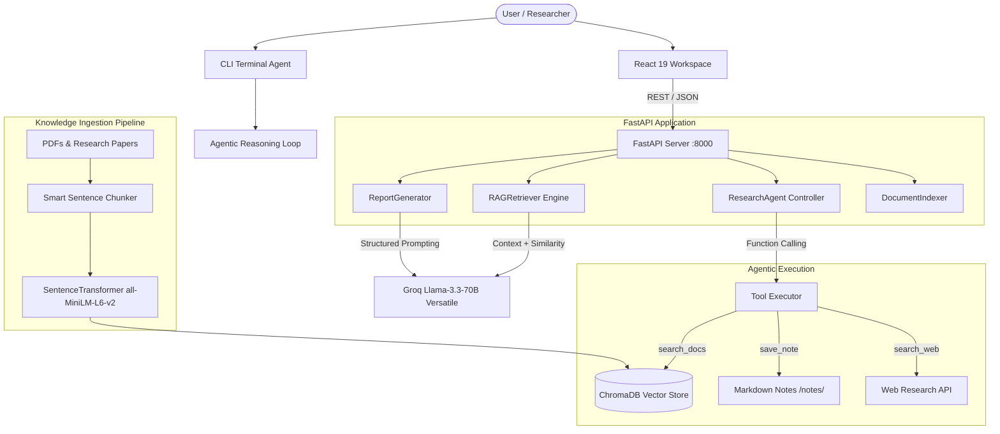

# Autonomous AI Research Agent & RAG Suite

> An end-to-end autonomous research assistant that pairs **Retrieval-Augmented Generation (RAG)** with **Agentic multi-step reasoning**, **dynamic function calling**, **automated report synthesis**, and a sleek **React 19 research workspace**.


[](https://www.linkedin.com/in/ankur-pal-2b2ba9433)

---

## Table of Contents
- [Overview](#overview)
- [System Architecture](#system-architecture)
- [Core Capabilities](#core-capabilities)
- [Project Structure](#project-structure)
- [Quick Start](#quick-start)
- [API Reference](#api-reference)
- [Agentic Tools](#agentic-tools)
- [License](#license)

---

## Overview

The **Autonomous AI Research Agent** bridges the gap between static document QA and autonomous deep investigation. Instead of merely answering questions against a fixed context window, the assistant can:
1. **Autonomously Reason:** Break complex questions into sub-goals using a multi-iteration ReAct loop.
2. **Execute Tools:** Search local PDF/MD archives with ChromaDB, query external web sources, and persist synthesized findings as markdown notes.
3. **Generate Structured Research Reports:** Produce Executive Summaries, Comprehensive Research Briefs, and Cross-Topic Comparative Analyses with zero hallucinations.
4. **Interactive Dashboard:** Provide researchers with an intuitive interface built with React 19 and Vite.

---

## System Architecture



---

## Core Capabilities

### 1. Multi-Step Agentic Reasoning (`agent.py`)
- Employs function calling with `llama-3.3-70b-versatile` over up to 6 iterations.
- Dynamically decides when to query the document collection, when to take notes, and when to synthesize the final answer.

### 2. Semantic Document Ingestion (`indexer.py`, `chunker.py`, `embedder.py`)
- Overlapping sliding-window chunker with sentence-boundary detection.
- Fast local embeddings via `all-MiniLM-L6-v2` (~80MB footprint, zero per-token embedding cost).
- Disk-backed ChromaDB persistence with cosine distance indexing.

### 3. Automated Synthesis & Report Generation (`report_generator.py`)
- **Bullet Summary:** Extracts high-impact takeaways with individual source citations and confidence metrics.
- **Research Brief:** Synthesizes multi-paragraph research papers with executive abstract, key findings, and knowledge gap identification.
- **Comparative Analysis:** Compares two distinct topics across technical differences, shared aspects, and relative trade-offs.

### 4. Full-Stack Research Workspace (`research-ui/`)
- Real-time chat with streaming agent responses.
- Document management with live file upload and indexing.
- One-click report generator with copyable Markdown view.

---

## Project Structure

```
Autonomous-AI-Research-Agent/
├── agent.py                 # Multi-iteration ReAct agent with function calling
├── agent_main.py            # CLI entrypoint for autonomous agent mode
├── chunker.py               # Document chunking with sentence boundary preservation
├── embedder.py              # SentenceTransformer wrapper (all-MiniLM-L6-v2)
├── indexer.py               # Complete document indexing pipeline
├── main.py                  # CLI entrypoint for standard conversational RAG
├── prompt_builder.py        # Context budget & strict grounding prompt generator
├── report_generator.py      # Structured JSON/Markdown report synthesizer
├── research_assistant.py    # Direct conversational assistant
├── retriever.py             # RAG pipeline with similarity thresholds
├── server.py                # FastAPI backend endpoints
├── tools.py                 # Tool schemas & execution dispatch
├── vector_store.py          # Persistent ChromaDB abstraction
├── requirements.txt         # Python dependencies
├── .env.example             # Template for API credentials
├── docs/                    # Sample research PDFs (AI strategy, NLP, HCLS)
├── notes/                   # Storage for agent-generated research notes
└── research-ui/             # React 19 + Vite frontend application
    ├── src/
    │   ├── App.jsx          # Main research dashboard
    │   └── App.css          # Styling
    ├── package.json
    └── vite.config.js
```

---

## Quick Start

### Prerequisites
- Python 3.10+
- Node.js 18+ and npm
- Free Groq API Key ([console.groq.com](https://console.groq.com))

### 1. Backend Setup

```bash
# Clone the repository
git clone https://github.com/FresherMen/Autonomous-AI-Research-Agent.git
cd Autonomous-AI-Research-Agent

# Create and activate virtual environment
python3 -m venv venv
source venv/bin/activate  # On Windows: venv\Scripts\activate

# Install dependencies
pip install -r requirements.txt

# Configure environment variables
cp .env.example .env
# Open .env and add your GROQ_API_KEY
```

### 2. Index Documents & Run Backend

```bash
# Index sample papers in docs/ (runs once)
python indexer.py

# Launch FastAPI backend
python server.py
# Server runs at http://localhost:8000 (Swagger docs at http://localhost:8000/docs)
```

### 3. Launch Frontend Dashboard (Optional)

```bash
cd research-ui
npm install
npm run dev
# Dashboard available at http://localhost:5173
```

### 4. Or Run via CLI

```bash
# Interactive Autonomous Agent CLI
python agent_main.py

# Standard RAG Q&A CLI
python main.py
```

---

## API Reference

| Method | Endpoint | Description |
|---|---|---|
| `POST` | `/ask` | Ask a grounded question against indexed documents |
| `POST` | `/agent` | Invoke the autonomous multi-step research agent |
| `POST` | `/report` | Generate structured reports (`bullet_summary`, `research_brief`, `comparison`) |
| `POST` | `/index` | Upload and dynamically index new documents |
| `GET` | `/docs` | List all currently indexed documents in ChromaDB |

---

## Agentic Tools

The autonomous agent is equipped with function definitions for:
1. `search_docs(query: str, top_k: int = 4)`: Performs vector similarity search across indexed literature.
2. `search_web(query: str)`: Queries live online sources for recent developments.
3. `save_note(title: str, content: str)`: Persists structured analysis directly into `./notes/` as a timestamped Markdown document.

---

## Author & Connect

**Ankur Pal**  
- **LinkedIn:** [Ankur Pal](https://www.linkedin.com/in/ankur-pal-2b2ba9433)  
- **GitHub:** [@FresherMen](https://github.com/FresherMen)  
- **Portfolio:** [freshermen.github.io](https://freshermen.github.io)  

---

## License

This project is licensed under the MIT License.
